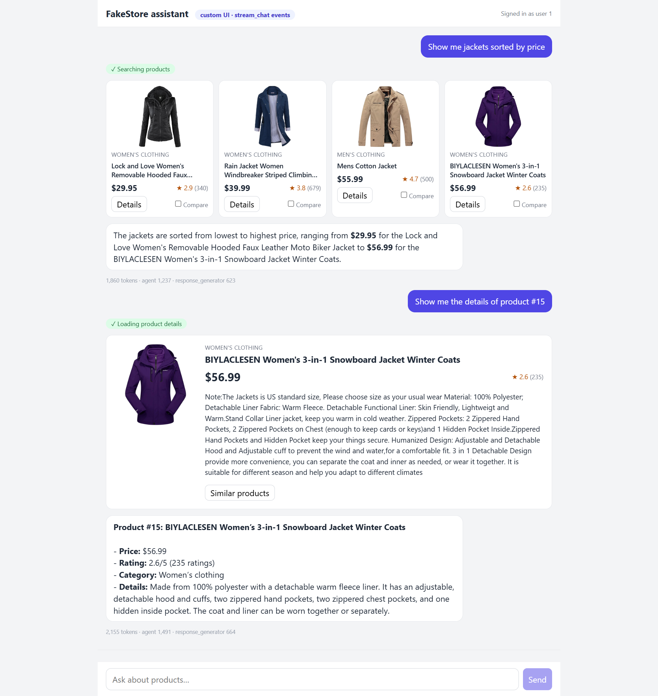
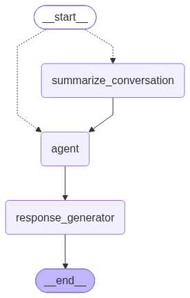
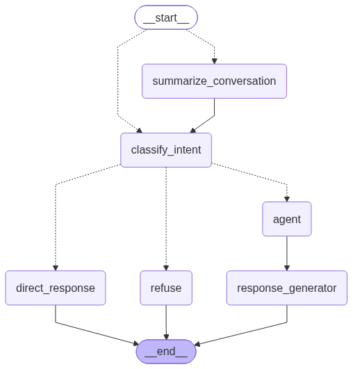
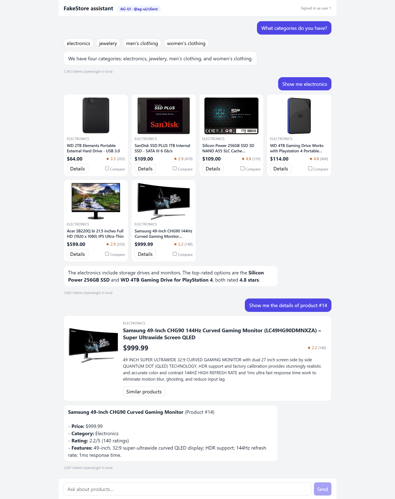
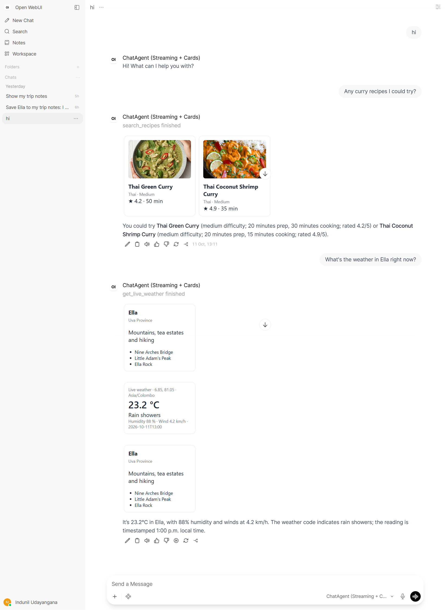

<div align="center">

# 🚀 Bootstrap Agent SDK

**An agent SDK for config-driven chat agents.**

[](https://www.python.org/)
[](https://langchain-ai.github.io/langgraph/)
[](https://modelcontextprotocol.io/)
[](https://docs.ag-ui.com/)
[](pyproject.toml)

Describe an agent in **one JSON file** (model, instructions, REST APIs, MCP servers, intents) and get a production-ready chat agent built on LangChain and LangGraph, with tool use, conversation summarization, streaming events for rich UIs and token usage. No graph code to write.

[Quick start](#-quick-start) · [API](#-api) · [Tools](#-tools) · [Streaming](#-streaming-to-a-ui) · [Configuration](#-configuration) · [Examples](#-examples)



<sub>The <a href="examples/custom_ui/README.md">custom UI example</a>: tool results render as product cards while the reply streams in.</sub>

</div>

## ✨ Features

| | |
|---|---|
| 📄 **Config-driven** | One JSON file defines the model, prompts and tools. Any LangChain model (`openai:...`, `anthropic:...`, `google_genai:...`) or OpenAI-compatible endpoint. |
| 🧰 **Every kind of tool** | Your own Python functions, ready-made LangChain/LangGraph tools, REST endpoints declared in JSON (no code), and MCP servers. |
| 🎨 **Rich UIs** | Tools can return structured data next to their text. The frontend renders it as cards, tables or charts; the library stays UI-agnostic. |
| ⚡ **Streaming** | A small, versioned event stream that maps cleanly to SSE, AG-UI or Open WebUI. |
| 🧠 **Long conversations** | Older messages are summarized automatically. |
| 🧭 **Intent routing** | Optional: send each message to a focused agent, a direct reply or a refusal. |
| 📊 **Observability** | Token usage per turn and per step; LangSmith tracing through environment variables. |
| 🔒 **Secure by design** | Per-user values (user id, access tokens) travel in a server-side `payload` and are never visible to the model. |

## 📦 Installation

Requires Python 3.10+.

```bash
git clone https://github.com/indunil-19/bootstrap_agent_sdk.git && cd bootstrap_agent_sdk
python -m venv .venv
.venv\Scripts\activate           # Windows (macOS/Linux: source .venv/bin/activate)
pip install -e .                 # package name: bootstrap-agent-sdk
cp .env.example .env             # then add OPENAI_API_KEY (or ANTHROPIC_API_KEY)
```

## 🏁 Quick start

**1. Describe the agent** in `agent_config.json`:

```json
{
  "llm_model": "openai:gpt-4o-mini",
  "llm_temperature": 0.0,
  "agent_instructions": "You are a helpful shopping assistant. Use the tools to answer.",
  "response_instructions": "Answer in a friendly tone, in one to three sentences."
}
```

**2. Create the agent and chat:**

```python
import asyncio
from dotenv import load_dotenv
from bootstrap_agent import ChatAgent

load_dotenv()

async def main():
    agent = await ChatAgent.create("shop", "agent_config.json")
    result = await agent.chat("Hi, what can you do?", chat_id="chat-1")
    print(result["text"])

asyncio.run(main())
```

> [!TIP]
> The next sections add tools, a payload and chat history to this agent.

## 📘 API

### `ChatAgent.create(name, config_path, tools=None, log_level=logging.INFO)`

Builds the agent: loads the config and the LLM, builds the HTTP tools, connects to the MCP servers and compiles the graph.

| Argument | Description |
|---|---|
| `name` | Agent name, used in logs. |
| `config_path` | Path to the JSON config. |
| `tools` | Optional list of Python / LangChain tools. HTTP and MCP tools from the config are added to them. |
| `log_level` | Logging level of the library's logs. |

> [!IMPORTANT]
> Always create agents with `await ChatAgent.create(...)` (`ChatAgent(...)` alone is not usable). Create the agent **once** at startup and reuse it for every user and conversation. It raises at startup if the config is invalid: unknown tool names, unset `${ENV_VAR}`s, unreachable MCP servers or duplicate tool names.

### `agent.chat(message, chat_id, payload=None, chat_history=None)`

Runs one turn and returns the result.

| Argument | Description |
|---|---|
| `message` | The user's message. |
| `chat_id` | Conversation id (the LangGraph `thread_id`). |
| `payload` | Optional server-side data for tools: user id, access tokens, locale… Never shown to the model. |
| `chat_history` | Optional earlier messages, oldest first, as `{"role", "content"}` dicts or LangChain messages. |

Returns:

```python
{
    "text": "The SanDisk SSD is cheaper, but the Silicon Power one is better rated.",
    "tool_outputs": [{"call_id": "call_1", "name": "compare_products", "data": [...]}],
    "usage": {"input_tokens": 2051, "output_tokens": 746, "total_tokens": 2797, "llm_calls": 3,
              "by_step": {"agent": {...}, "response_generator": {...}}},
}
```

`tool_outputs` holds the structured data of the tools that ran (for the UI). `usage` is `None` when `"token_usage": false` or the provider reports no usage.

Same arguments, different output:

- `agent.start_chat(...)` returns only the reply text.
- `agent.stream_chat(...)` yields events while the turn runs (see [Streaming to a UI](#-streaming-to-a-ui)).

### 💬 Chat history

The agent keeps no conversation state between calls: your application stores the messages and sends the earlier ones with every turn.

```python
history = []

for message in ["Find a backpack under $120", "Is it waterproof?"]:
    result = await agent.chat(message, chat_id="chat-1", chat_history=history)
    history += [{"role": "user", "content": message},
                {"role": "assistant", "content": result["text"]}]
```

Long histories are summarized automatically, so you can always send the full list.

### 🔑 Payload

The payload carries per-request values that the **server** knows and the model must not choose or see, such as the signed-in user:

```python
result = await agent.chat(
    "What's in my cart?",
    chat_id="chat-1",
    payload={"user_id": 42, "access_token": token},   # set from your auth, never from the browser
)
```

Python tools read it from their `config` argument, and HTTP tools insert it with `{payload.key}` placeholders (see below). The library also adds `chat_history` to the payload, and `intent` when intent classification is on.

> [!WARNING]
> Never take the payload from the browser request. Set it on the server from your authentication, so a user can't ask for someone else's data.

## 🧰 Tools

| Kind | Declared in | Gets the payload | UI data |
|---|---|---|---|
| 🐍 [Python tools](#-python-tools) | `tools=[...]` | ✅ | Return `(text, data)` |
| 📚 [LangChain / LangGraph tools](#-built-in-langchain--langgraph-tools) | `tools=[...]` | — | — |
| 🌐 [HTTP tools](#-http-tools) | `http_tools` in the config | ✅ | `"artifact": true` |
| 🔌 [MCP tools](#-mcp-tools) | `mcp_servers` in the config | ❌ | Automatic for JSON results |

### 🐍 Python tools

Pass any LangChain tool in `tools`. To give the UI structured data, use `response_format="content_and_artifact"` and return `(text, data)`; the model sees only the text.

```python
from langchain_core.runnables import RunnableConfig
from langchain_core.tools import tool

@tool(response_format="content_and_artifact")
def get_my_orders(config: RunnableConfig):
    """Get the signed-in user's orders."""
    user_id = config["configurable"]["payload"]["user_id"]   # from the payload, not the model
    orders = load_orders(user_id)
    return f"{len(orders)} orders", orders

agent = await ChatAgent.create("shop", "agent_config.json", tools=[get_my_orders])
```

### 📚 Built-in LangChain / LangGraph tools

Ready-made tools work the same way: anything that is a LangChain `BaseTool`, such as web search, Wikipedia or a calculator from `langchain-community` or a provider package.

```python
from langchain_community.tools import DuckDuckGoSearchRun, WikipediaQueryRun
from langchain_community.utilities import WikipediaAPIWrapper

tools = [get_my_orders, DuckDuckGoSearchRun(), WikipediaQueryRun(api_wrapper=WikipediaAPIWrapper())]
agent = await ChatAgent.create("shop", "agent_config.json", tools=tools)
```

Install the packages these tools need (for example `pip install langchain-community duckduckgo-search wikipedia`).

### 🌐 HTTP tools

REST endpoints declared under `http_tools`, with no code. Each entry becomes a tool named after its key:

```json
"http_tools": {
  "get_order": {
    "description": "Get one of the user's orders by its id.",
    "method": "GET",
    "url": "https://api.example.com/users/{payload.user_id}/orders/{order_id}",
    "params": {
      "order_id": {"type": "integer", "description": "Order id, e.g. 1042"}
    },
    "headers": {"Authorization": "Bearer {payload.access_token}", "X-Api-Key": "${SHOP_API_KEY}"},
    "response_path": "data",
    "artifact": true
  }
}
```

Values can use two kinds of placeholders, never visible to the model:

- `${ENV_VAR}` is read from the environment once, at startup (API keys).
- `{payload.key}` is read from the payload on every call (per-user ids and tokens).

<details>
<summary><b>All HTTP tool fields</b></summary>

| Field | Description |
|---|---|
| `description` | What the tool does (shown to the model). **Required.** |
| `url` | Endpoint URL; `{param}` marks a path parameter. **Required.** |
| `method` | `GET` (default), `POST`, `PUT`, `PATCH` or `DELETE`. |
| `params` | Arguments the model fills in: `type`, `description`, `required` (default `true`), `default`, `enum`, `in` (`path`, `query` or `body`). |
| `headers`, `query`, `body` | Fixed values sent with every call. |
| `auth` | `{"type": "basic", "username": ..., "password": ...}` |
| `response_path` | Dotted path to the part of the JSON response to return, e.g. `data.items`. |
| `artifact` | `true` to also return the data to the UI (or a dotted path into the response). |
| `timeout`, `max_response_chars` | Defaults: 10 s and 8000 characters. |

</details>

### 🔌 MCP tools

MCP servers declared under `mcp_servers`, using local (`stdio`) or remote (`streamable_http`) servers. `tools` lists which of the server's tools to load:

```json
"mcp_servers": {
  "time": {
    "transport": "stdio",
    "command": "uvx",
    "args": ["mcp-server-time"],
    "tools": ["get_current_time", "convert_time"]
  },
  "jira": {
    "transport": "streamable_http",
    "url": "https://mcp.example.com/mcp",
    "headers": {"Authorization": "Bearer ${JIRA_TOKEN}"},
    "tools": ["search_issues"]
  }
}
```

<details>
<summary><b>All MCP server fields</b></summary>

| Field | Description |
|---|---|
| `transport` | `stdio` (runs a local command) or `streamable_http` (remote server). |
| `command`, `args`, `env` | For `stdio`: the command that starts the server. |
| `url`, `headers` | For `streamable_http`: the server URL and headers. |
| `tools` | Tools to load. If omitted, all tools are loaded with a warning. |

</details>

MCP tools that return JSON produce UI data automatically. To see which ones do, run `python -m bootstrap_agent.mcp_ui_check agent_config.json`. MCP tools run out of process, so they don't receive the payload. See [docs/MCP.md](docs/MCP.md).

## ⚙️ How it works

Each turn runs through a LangGraph `StateGraph`:

<table>
  <tr>
    <th>Default</th>
    <th>With intent classification</th>
  </tr>
  <tr>
    <td valign="top" align="center"></td>
    <td valign="top" align="center"></td>
  </tr>
</table>

| Step | What it does |
|---|---|
| `summarize_conversation` | Folds the oldest messages into a running summary when the history gets long (more than 20 messages). |
| `classify_intent` | With intent classification on: picks the message's intent and its route. |
| `agent` | A ReAct agent that calls tools until it has an answer. |
| `response_generator` | Rewrites that answer into the final reply, applying `response_instructions`. |
| `direct_response` | Replies without tools (small talk), or with a fixed message. |
| `refuse` | Politely declines requests outside the agent's scope. |

Draw the graph of any config with `python draw_graph.py [config]`.

## ⚡ Streaming to a UI

`stream_chat()` takes the same arguments as `chat()` and yields events:

```python
async for event in agent.stream_chat("Compare the two SSDs", chat_id="chat-1",
                                     payload={"user_id": 42}, chat_history=history):
    print(event["type"], event["data"])
```

| Event | Meaning |
|---|---|
| ▶️ `run.started` | The turn started. |
| ⏳ `tool.started` | A tool is running (show a status). |
| ✅ `tool.finished` | A tool finished; `data` holds its structured output (render a card). |
| ✍️ `message.delta` | The next piece of the reply. |
| 🏁 `run.finished` | The final `text`, all `tool_outputs` and `usage`. |
| ❌ `run.error` | The turn failed. |

Send them to the browser as Server-Sent Events, or translate them to a protocol such as AG-UI. See [docs/rich-ui-streaming.md](docs/rich-ui-streaming.md).

## 🔧 Configuration

| Key | Description |
|---|---|
| `llm_model` | `provider:model`, e.g. `openai:gpt-4o-mini`, `anthropic:claude-sonnet-5-5`. **Required.** |
| `llm_base_url` | Optional OpenAI-compatible endpoint |
| `llm_temperature` | Sampling temperature |
| `agent_instructions` | System prompt of the tool-using agent |
| `response_instructions` | Style of the final reply (tone, length, units) |
| `recursion_limit` | Maximum graph steps per turn (default 50) |
| `token_usage` | Count tokens (default `true`) |
| `http_tools` | REST endpoints as tools ([above](#-http-tools)) |
| `mcp_servers` | MCP servers and the tools to load from each ([above](#-mcp-tools)) |
| `intent_classification` | Optional intent routing (below) |

<details>
<summary><b>Intent classification example</b></summary>

```json
"intent_classification": {
  "enabled": true,
  "intents": {
    "order_support": {"description": "Orders, delivery, refunds", "tools": ["get_order"]},
    "small_talk":    {"description": "Greetings, thanks", "route": "direct"},
    "out_of_scope":  {"description": "Unrelated requests", "route": "refuse", "message": "Sorry, I can only help with orders."}
  }
}
```

Each intent has a `description` and a `route`: `agent` (default; optionally limited to some `tools`), `direct` (no tools) or `refuse`. Messages that match no intent go to the full agent.

</details>

Full reference: [CLAUDE.md](CLAUDE.md#configuration).

## 🧩 Examples

| Example | Frontend | Scenario |
|---|---|---|
| 🛒 [Custom UI](examples/custom_ui/README.md) | React app reading `stream_chat()` events | FakeStore shopping assistant: search, comparison table, cart |
| 🔗 [AG-UI](examples/agui/README.md) | React app with `@ag-ui/client` | The same shopping assistant over the AG-UI protocol |
| 🌴 [Open WebUI](examples/openwebui/README.md) | Open WebUI Pipe with HTML cards | Sri Lanka travel assistant: destinations, live weather, recipes, trip notes (MCP) |

<table>
  <tr>
    <td width="50%" align="center"><br><sub>AG-UI: categories, product grid and details</sub></td>
    <td width="50%" align="center"><br><sub>Open WebUI: recipe and live weather cards</sub></td>
  </tr>
</table>

## 📚 Documentation

- 🎨 [Rich UIs and streaming](docs/rich-ui-streaming.md): tool data, events, SSE, AG-UI and Open WebUI
- 🔌 [MCP tools](docs/MCP.md): connecting MCP servers and rendering their results
- 🏗️ [Configuration and architecture](CLAUDE.md)

## 🧪 Development

There is no unit test suite yet; the scripts in `tests/` make real LLM calls and are run directly, for example `python tests/test_stream.py`. LangSmith tracing is enabled with `LANGSMITH_TRACING=true` and `LANGSMITH_API_KEY` in `.env`.
